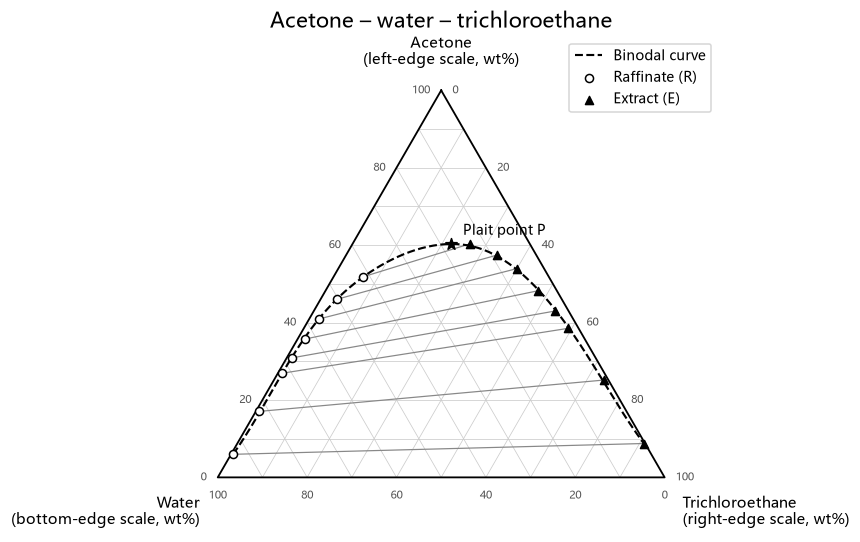
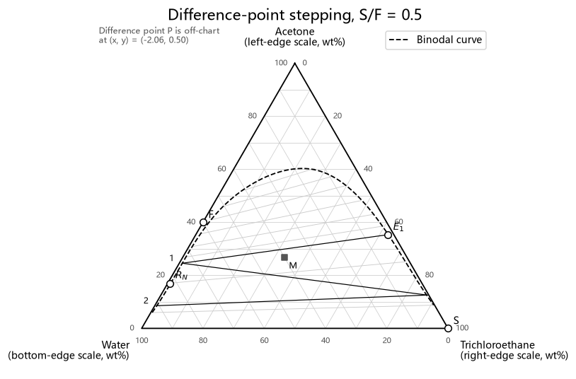
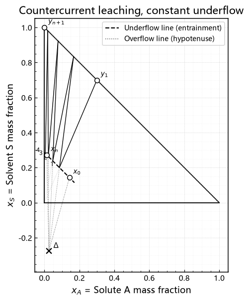
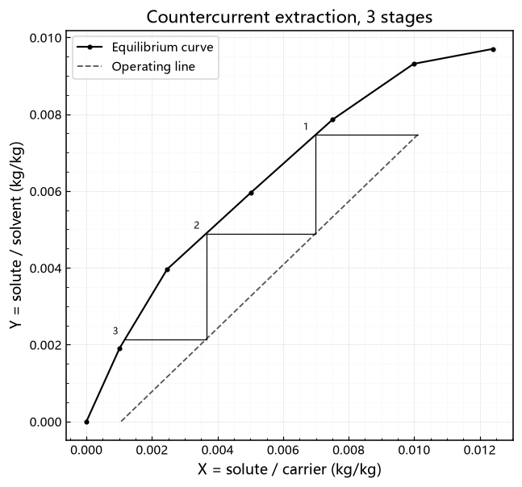
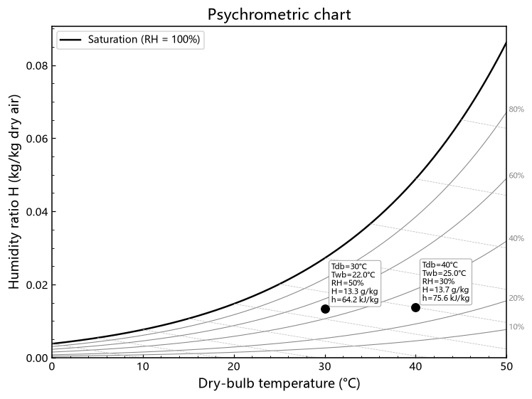
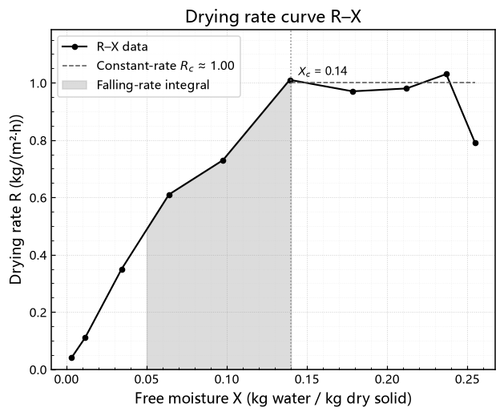

# chemeng-plots

[](https://github.com/iZHENGjy/chemeng-plots/actions/workflows/tests.yml)


**Tested graphical-method plots for chemical engineering separations** — ternary diagrams, stage stepping, leaching, drying, filtration and psychrometrics in one call each.

The graphical methods of a unit-operations course (step off stages, find the difference point, read a psychrometric chart) are exactly what people — and LLMs — get wrong when they redraw them from scratch every time. Each function here draws the construction correctly, **returns the numbers it read off**, and is checked against a known answer.

化工分离过程 / 单元操作图解法画图库：三元相图、阶梯法、固液萃取、干燥、过滤、湿度图，一个函数一张图，每个都用已知答案验证过。图上文字中英可切换。

<table>
<tr>
<td></td>
<td></td>
<td></td>
</tr>
<tr>
<td></td>
<td></td>
<td></td>
</tr>
</table>

## Install

```bash
pip install "git+https://github.com/iZHENGjy/chemeng-plots"            # core
pip install "chemeng-plots[psychro] @ git+https://github.com/iZHENGjy/chemeng-plots"   # + psychrometric chart
```

## Quick start

```python
import chemeng_plots as cp
from chemeng_plots.datasets import SYSTEM_1

fig, ax, res = cp.plot_lle_d_system(
    SYSTEM_1["raffinate"], SYSTEM_1["extract"],
    F=(40, 60, 0), S=(0, 0, 100), RN=(17.04, 82.23, 0.73),
    S_over_F=0.5, labels=SYSTEM_1["labels"],
)
print(res["n_stages"], res["reached_target"])   # 2 True
print(cp.coords_table(res))                     # every construction point, for graph paper
fig.savefig("stages.png")
```

Every `plot_*` returns `(fig, ax, result)`. `result` holds the computed values plus `result["coords"]` — every plotted point, so you can copy the construction onto paper or check it by hand.

Chinese labels: `cp.set_language("zh")`.

## What's inside

| Function | Draws | Returns |
|---|---|---|
| `plot_ternary` | LLE ternary diagram: binodal, tie lines, plait point, optional mixing point and F–S line | plait point |
| `plot_distribution` | distribution curve with `y = x` reference | — |
| `plot_mccabe_thiele` | countercurrent stage stepping; design mode (how many stages?) or rating mode (where do *n* stages get me?) | `n_stages`, `x_final`, `reached_target` |
| `plot_lle_d_system` | partially miscible countercurrent extraction: difference point P + stepping on the ternary diagram; E₁ from the solvent ratio if not given | `n_stages`, `difference_point`, `reached_target` |
| `plot_sle_right_triangle` | countercurrent leaching on the right-triangle diagram: net-flow point Δ + stepping, optional full construction rays | `n_stages`, `net_flow_point` |
| `plot_drying_curve` | drying rate curve R–X, critical moisture, shaded falling-rate integral | `falling_integral` = ∫dX/R |
| `plot_filtration_linear` | constant-pressure filtration t/V vs V with least-squares fit | `slope`, `intercept`, `K_p` |
| `plot_psychrometric_chart` | saturation line, RH family, wet-bulb lines, annotated state points (via `psychrolib`) | Tdb, Twb, RH, H, h, Tdew per point |

Helpers: `ternary_to_xy`, `lever_rule`, `falling_rate_integral`, `entrainment_to_xy`, `coords_table`; styles `apply_chemeng_style` (black-and-white engineering) and `apply_pro_style` (Okabe-Ito colour).

## How it's verified

`pytest` runs every plot against an answer it must hit:

| Check | Reference |
|---|---|
| 3 countercurrent stages reach the tutorial raffinate X₃ = 1.058×10⁻³ | worked tutorial answer |
| Falling-rate ∫dX/R ≈ 0.1276 | hand-computed trapezoid |
| 30 °C / 50 % RH → H ≈ 13.3 g/kg, h ≈ 64 kJ/kg | standard psychrometric chart |
| Leaching right-triangle stepping = stepping the same problem in concentration space | independent construction |
| Difference-point stepping in the near-immiscible limit = 5 stages, stage by stage within 0.002 | stepping in solute-free ratio coordinates |
| Lever rule recovers a 50 : 100 kg mix exactly | geometry |

When a construction cannot finish — tie-line data ends before the target, or the operating line pinches the equilibrium curve — the function **warns and sets `reached_target=False`** rather than silently reporting a stage count that is too low.

```bash
pip install -e ".[test]"
pytest
python examples/gallery.py   # regenerates docs/images/
```

## Origin

Extracted from the `chemeng-coursework` plugin of [claudesidian-learning-os](https://github.com/iZHENGjy/claudesidian-learning-os), where Claude Code calls these functions instead of improvising plots for homework. Built while studying unit operations at Xiamen University Malaysia.

Example tie-line tables in `chemeng_plots.datasets` were transcribed from coursework; check the original handbook source before citing them.

## License

MIT
